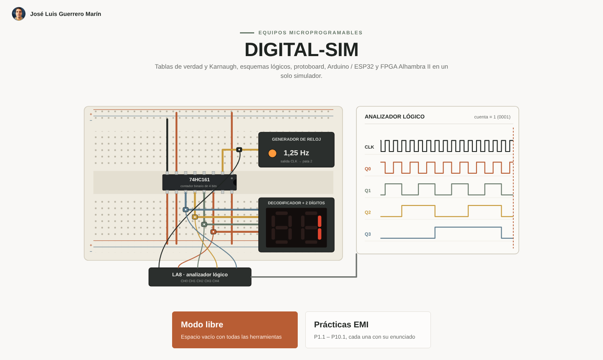
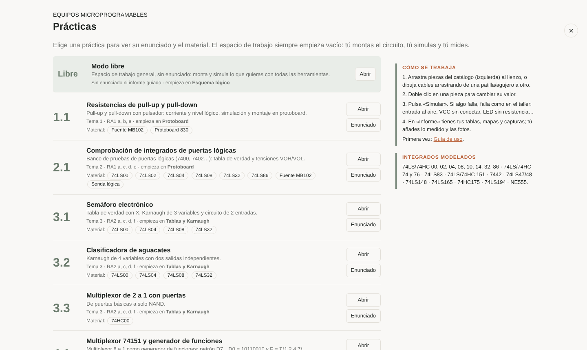
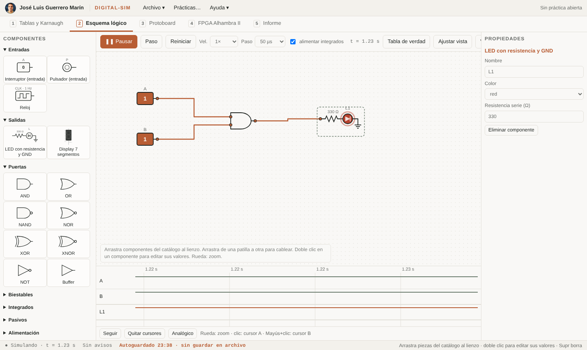
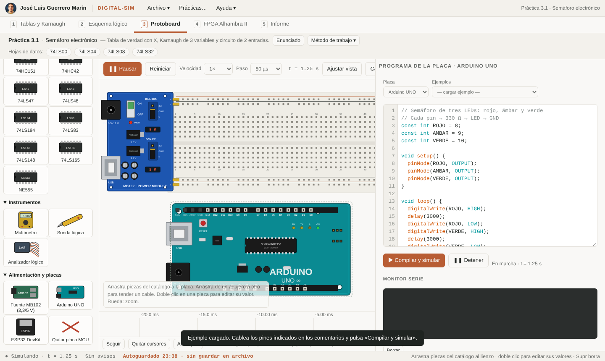
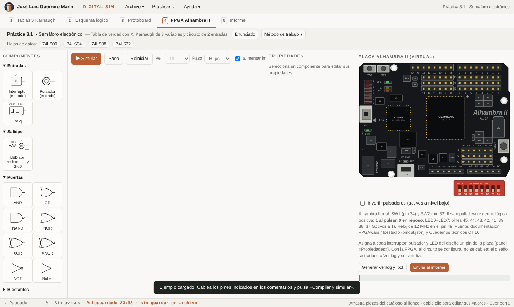
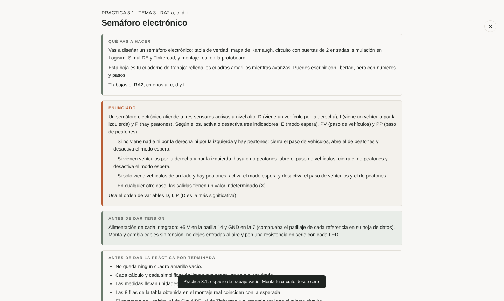

# DIGITAL-SIM

Simulador todo en uno para el módulo **Equipos Microprogramables** (FP, Electrónica). Es un único archivo HTML que funciona sin instalar nada ni conectarse a internet.

**Pruébalo:** https://nutshell-electronica.github.io/digital-sim/

Autor: José Luis Guerrero Marín.

Al abrirlo, la pantalla de inicio muestra un contador de 4 bits animado con su analizador lógico y su display, y ofrece dos caminos: **Modo libre** o **Prácticas EMI**.

## Qué incluye

| Pestaña | Sustituye a | Para qué sirve |
|---|---|---|
| 1 · Tablas y Karnaugh | Logisim | Tabla de verdad, mapa de Karnaugh, simplificación y circuito |
| 2 · Esquema lógico | SimulIDE | Puertas, biestables e integrados 74xx con su patillaje, cronograma, sonda y analizador |
| 3 · Protoboard | Tinkercad | Protoboard de 830 puntos, fuente MB102, multímetro, sonda lógica, analizador de 8 canales y placas Arduino UNO / ESP32-S3 DevKitC-1 con su programa |
| 4 · FPGA Alhambra II | Icestudio | Diseño con puertas, asignación de pines y placa virtual |
| 5 · Informe | — | Informe de la práctica con tus capturas y medidas |

Las prácticas P1.1–P10.1 se abren **vacías**: el alumno monta el circuito desde cero. El simulador ayuda, pero permite equivocarse (cortocircuitos, LED sin resistencia, tensiones excesivas) y lo marca con una llama y la causa del fallo. También hay un **modo libre** sin enunciado.

## Capturas

### Esquema lógico con cronograma

### Protoboard con Arduino y editor de código
Al seleccionar la placa, el panel derecho muestra el programa con colores de Arduino, autocompletado, ejemplos precargados, monitor serie y LCD virtual.

### Alhambra II

### Enunciado de cada práctica

## Uso

1. Abre la web (o descarga `index.html` y ábrelo con cualquier navegador moderno).
2. Elige una práctica en **Prácticas…** o el modo libre.
3. Atajos: `Alt+1…5` cambian de pestaña, `R` gira, `Supr` borra, `F1` abre la guía.

El trabajo se autoguarda en el navegador. Para conservarlo, guárdalo en un archivo desde el menú **Archivo**.

## Limitaciones

- El código de Arduino/ESP32 es un **subconjunto de C++**: variables, funciones, `if/for/while`, `millis`, `delay`, `pinMode`, `digitalRead/Write`, `analogRead/Write`, `Serial`, `sprintf` y `LiquidCrystal`. No hay interrupciones, I²C ni SPI reales.
- Es un simulador pedagógico de paso fijo, no SPICE: no sustituye a la medida en el banco.
- La Alhambra II se dibuja a partir de la serigrafía de la placa, no es una copia exacta.

## Estructura del repositorio

- `index.html`: el simulador completo (lo que sirve GitHub Pages).
- `fuente/`: código fuente por módulos; `python3 build.py` los concatena en un solo HTML (ajusta las rutas del script a tu copia).
- `docs/img/`: capturas.

## Datos de referencia

Pines de la Alhambra II verificados con la documentación de FPGAwars/Icestudio (pinout.json).
